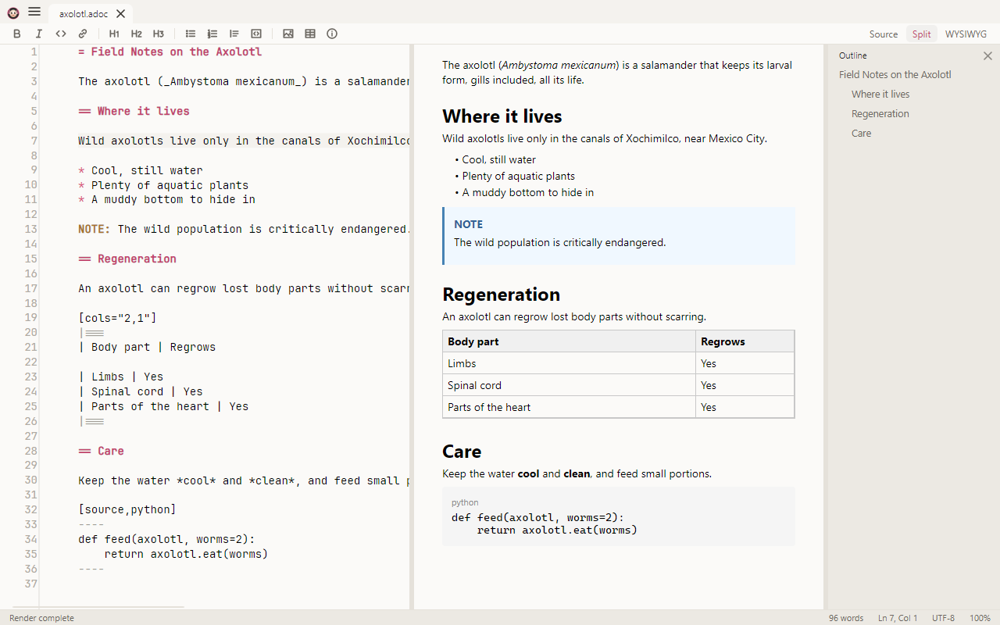
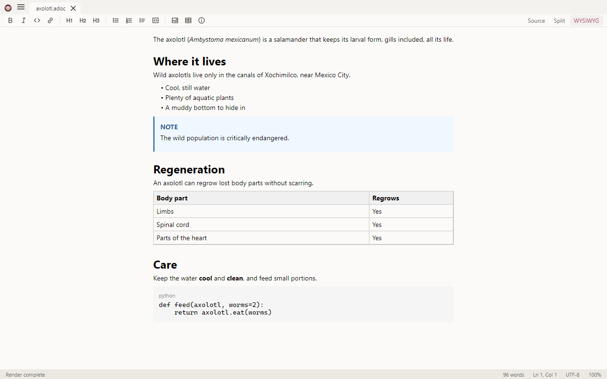

<p align="center">
  
</p>

<h1 align="center">Ascolotl</h1>

<p align="center">A focused AsciiDoc and Markdown editor with live preview and PDF export.<br>
Windows · macOS · Linux</p>

---

Ascolotl keeps the screen for your document. Write AsciiDoc or Markdown on the
left and see it rendered on the right, or edit the rendered page directly. Then
export to PDF, HTML, EPUB or DocBook. Everything runs locally: no browser engine,
no Ruby and no Java.





## Features

- **AsciiDoc and Markdown:** open, edit, preview and export `.adoc` and `.md`
  files. Markdown follows CommonMark, with GitHub's tables, task lists,
  strikethrough, autolinks and footnotes. Syntax colouring follows each file's
  format, and the toolbar and menus write its syntax.
- **Three ways to work:** Source, Split (source and live preview side by side)
  and WYSIWYG. Switch from the toolbar's right end or with `Ctrl+1`, `Ctrl+2`
  and `Ctrl+3`. Each tab keeps its own view, and files open in WYSIWYG. Click a
  rendered block to edit its source in place (in Split, the source pane jumps
  there too), then apply with `Ctrl+Enter` or cancel with `Esc`. The source text
  stays the single source of truth.
- **Formatting toolbar and right-click menu** in Split and WYSIWYG: bold,
  italic, code, links, headings, lists, quotes, code blocks, images, tables and,
  in AsciiDoc, notes. Each applies to the selection or inserts at the caret.
- **Table editing:** insert and delete rows and columns from the toolbar or a
  right-click, in the source, in the preview or while editing a cell. AsciiDoc
  cells can also be merged and split. Markdown tables stay aligned.
- **Live preview** with images, checklists, quotes and highlighted text. Click
  the preview to jump to the source, and scrolling stays in sync.
- **Outline panel** on the right, as wide as you drag it, to jump between
  sections, and **project folders** with a file tree.
- **Export** to PDF (portrait or landscape for wide tables), HTML, EPUB,
  DocBook XML and a linked static website of a whole folder. **Export
  profiles** save one-click export settings. PDFs can be made **accessible**
  (tagged PDF/UA-1, for screen readers) with Export → Accessible PDF.
- **Styles:** load an asciidoctor-pdf theme (`.yml`) once and it styles every
  PDF, HTML and EPUB export and the live preview, title page included. A
  document's own `:pdf-theme:` still wins.
- **Page Preview** shows the document as the exported PDF's pages: title page,
  table of contents, headers and footers.
- **Completion and smart typing:** in AsciiDoc, macros, attributes and block
  snippets. In Markdown, link targets (files, headings, reference labels), code
  fence languages and block starters. Lists, quotes and code fences continue or
  close on `Enter`. `F1` opens a searchable syntax reference for the file's
  format.
- **Import** Word (`.docx`), Markdown, HTML, PDF and plain text files as
  AsciiDoc.
- **Command palette** (`Ctrl+Shift+P`) to reach every command by name.
- **Tabs and session restore:** reopen a closed tab, and come back to the tab
  you were on, each tab in its view and where it was scrolled. Unsaved work is
  recovered after a crash.
- **Light, dark or system theme**, with zoom and word wrap for each pane.
- **English, French, German, Italian or Spanish** interface, following the system language by
  default (View → Language).

## Install

Download the archive for your system from the
[Releases](https://github.com/sonatique/Ascolotl/releases) page. Each build is
self-contained, so you don't need to install .NET.

| System | Archive |
|---|---|
| Windows (x64) | `Ascolotl-<version>-win-x64.zip` |
| Windows (ARM64) | `Ascolotl-<version>-win-arm64.zip` |
| macOS, Apple Silicon | `Ascolotl-<version>-osx-arm64.tar.gz` |
| macOS, Intel | `Ascolotl-<version>-osx-x64.tar.gz` |
| Linux (x64) | `Ascolotl-<version>-linux-x64.tar.gz` |
| Linux (ARM64) | `Ascolotl-<version>-linux-arm64.tar.gz` |

Each archive holds the app (`Ascolotl.app` on macOS), its license (`LICENSE.txt`) and the licenses
of the components it includes (`THIRD-PARTY-NOTICES.txt`, also under
Help → About → Open-Source Licenses).

The archives don't register file types. To open `.adoc` and `.md` files with a
double-click, use your system's *Open with* once and choose Ascolotl, with
*Always* (Windows) or *Change All* (macOS, in Get Info).

**Windows:** unzip the archive and run `Ascolotl.exe`. The build is not signed,
so SmartScreen may warn you the first time. Choose *More info*, then *Run anyway*.

**macOS:** unpack the archive and move `Ascolotl.app` to Applications. The
build is not signed or notarized, so clear the quarantine flag once before the
first start:

```bash
tar -xzf Ascolotl-1.0.0-osx-arm64.tar.gz
```

```bash
xattr -dr com.apple.quarantine Ascolotl.app
```

```bash
open Ascolotl.app
```

**Linux:** needs X11, fontconfig and ICU (`libicu`), which standard desktop
distributions include. Unpack the archive and run `./Ascolotl`:

```bash
tar -xzf Ascolotl-1.0.0-linux-x64.tar.gz && ./Ascolotl
```

To add it to your applications menu, with its icon:

```bash
install -Dm755 Ascolotl ~/.local/bin/Ascolotl
install -Dm644 ascolotl.desktop ~/.local/share/applications/ascolotl.desktop
install -Dm644 ascolotl.png ~/.local/share/icons/hicolor/256x256/apps/ascolotl.png
```

## Keyboard shortcuts

| Action | Shortcut |
|---|---|
| New / Open / Open folder | `Ctrl+N` / `Ctrl+O` / `Ctrl+Shift+O` |
| Save / Save As / Save All | `Ctrl+S` / `Ctrl+Shift+S` / `Ctrl+Alt+S` |
| Close tab / Reopen closed tab | `Ctrl+W` / `Ctrl+Shift+T` |
| Next / previous tab | `Ctrl+Tab` / `Ctrl+Shift+Tab` |
| Export to PDF | `Ctrl+E` |
| Command palette | `Ctrl+Shift+P` |
| Apply / cancel an in-place edit (a table cell: add a row) | `Ctrl+Enter` / `Esc` |
| Completion | `Ctrl+Space` or `Tab` |
| Source / Split / WYSIWYG | `Ctrl+1` / `Ctrl+2` / `Ctrl+3` |
| Syntax reference (AsciiDoc or Markdown) | `F1` |
| Toggle outline | `Ctrl+B` |
| Zoom in / out / reset | `Ctrl++` / `Ctrl+-` / `Ctrl+0` |
| Move between the source and the page | `F6` |

On the WYSIWYG page (and the page in Split), one block at a time has the keyboard:

| Action | Keys |
|---|---|
| Previous / next block (below the last one: a new paragraph) | `↑` / `↓` |
| First / last block | `Home` / `End` |
| Edit the block (a table: its first cell) | `Enter` or `F2` |
| Block menu | `Shift+F10` or the Menu key |
| Select several blocks / all of them (`Esc`: none) | `Shift+↑` / `Shift+↓` / `Ctrl+A` |
| Copy / cut the block or the selected blocks | `Ctrl+C` / `Ctrl+X` |
| Move the block (or the selected blocks) up / down | `Ctrl+Shift+↑` / `Ctrl+Shift+↓` |
| Duplicate / delete the block | `Ctrl+Alt+D` / `Delete` |
| New paragraph after the block | `Ctrl+Shift+N` |
| Turn the block into a heading, list, quote, code block… | `Ctrl+/` |
| Heading level 1 to 6 / back to a paragraph (also in the source) | `Ctrl+Shift+1`…`6` / `Ctrl+Shift+0` |
| Undo / redo | `Ctrl+Z` / `Ctrl+Y` |
| Leave the page | `Tab` / `Shift+Tab` |

While a block is open, an arrow that can't move further inside it applies the edit and
opens the block above or below; below the last block, a new paragraph. `Esc` cancels
(a new paragraph goes away again) and `Ctrl+Enter` applies; both go back to moving
between blocks. In a paragraph or heading, `Enter` splits it in two at the caret (at its
start or end: a new paragraph above or below) and `Shift+Enter` starts a new line;
`Backspace` at the start of a paragraph joins it to the paragraph or heading above.
`Ctrl+A` selects the open block's text, then (in a table cell) its table, then every block.

In a table cell, `Tab` and `Shift+Tab` go to the next and previous cell, and the arrows
go on to the cell beside, above or below once they can't move further inside the cell,
`↑` and `↓` keeping to the column across merged cells. Past the
first or last cell they leave the table. `Ctrl+Enter` applies the cell and adds a row below it.

## Screen readers

On Windows (Narrator, NVDA) and macOS (VoiceOver), screen readers can read the
menus, dialogs, tabs and the WYSIWYG page. On the page, the block with the
keyboard is read out with its text; headings give their level and images their
alt text. The source editor gives them its whole text at once, not line by line. On Linux, the UI toolkit Ascolotl uses
(Avalonia 11) has no screen-reader support yet.

## Build from source

You need the [.NET 10 SDK](https://dotnet.microsoft.com/download).

```bash
dotnet build Ascolotl.slnx
```

```bash
dotnet test Ascolotl.slnx
```

```bash
dotnet run --project src/Ascolotl.App
```

To make release builds, run `publish.ps1` in PowerShell. It runs the tests first,
then publishes one self-contained, trimmed, compressed executable per runtime to
`publish/<runtime>/` and the release archives to `publish/dist/`:

```powershell
.\publish.ps1                     # win, osx and linux, each x64 and arm64
.\publish.ps1 -Runtime win-x64    # a single runtime
```

## Project layout

| Path | Contents |
|---|---|
| `src/Ascolotl.App` | Avalonia desktop app: windows, views, dialogs and file pickers |
| `src/Ascolotl.Core` | View models, editing logic (formatting, tables, completion), document model and the AsciiDoc and Markdown parsing |
| `src/Ascolotl.Infrastructure` | Settings, session, crash-recovery storage and the log |
| `src/Ascolotl.Export` | PDF, HTML, EPUB, DocBook and website export; Word, Markdown, HTML and PDF import |
| `tests/Ascolotl.Tests.Unit` | Unit tests |
| `example-documents/` | Sample AsciiDoc files for manual testing |

Ascolotl is built on [Avalonia](https://avaloniaui.net/),
[AvaloniaEdit](https://github.com/AvaloniaUI/AvaloniaEdit) and
[AdocNet](https://github.com/sonatique/Adoc.Net), a managed AsciiDoc (and
Markdown) parser and renderer.

## License

Copyright (C) 2026 Sylvain Fasel

Ascolotl is free software, licensed under the
[GNU General Public License v3.0](LICENSE).
